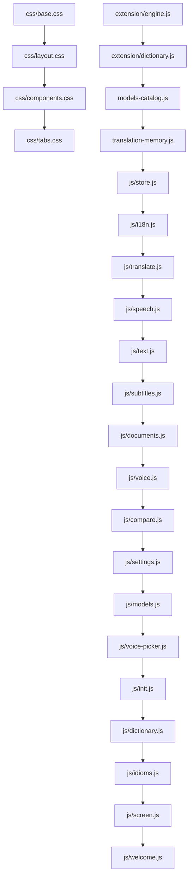

# MAKAN Translate: Index.html Code Map & Split Architecture

This document maps every section of `index.html` (CSS blocks, HTML markup blocks, and JavaScript blocks), detailing original line ranges, responsibilities, dependencies, and target files.

## Architectural Principles & Constraints

1. **Pure Move**: Code and styles are moved verbatim without modifications, formatting changes, renames, or refactoring.
2. **Classic Scripts (`<script src="...">`)**: Modules (`type="module"`), `defer`, or `async` are strictly avoided. Variables and functions must remain shared in the global scope across files in original execution order.
3. **Strict Load Ordering**: The concatenation and load order of split files corresponds exactly to the original inline positions in `index.html`.
4. **No Build Step**: No bundler, transpiler, or minifier is introduced.
5. **Markup Retained**: HTML markup blocks remain in `index.html` with inline `<style>` and `<script>` replaced by corresponding `<link>` and `<script src="...">` tags.

---

## 1. CSS Sections (Lines 14 – 474)

Originally contained in a single `<style>` block (lines 14 to 474). Split into 4 modular stylesheets loaded sequentially via `<link rel="stylesheet">`:

| Original Lines | Target File | Section / Purpose | Dependencies / Notes |
|---|---|---|---|
| 15 – 87 | `css/base.css` | `:root` theme variables, CSS reset, typography, base layout (`.wrap`), navigation header (`.nav`, `.brand`, `.mark`), action buttons (`.btn`, `.cta`, `.ghost`, `.rec`, `.danger`), keycaps (`kbd`), main title (`.head`, `h1`), tab navigation bar (`.tabs`), and language options bar (`.bar`, inputs, selects, `#swap`). | Foundation tokens (`--bg`, `--accent`, fonts) required by all subsequent styles. |
| 88 – 170 | `css/layout.css` | Translation panes layout (`.panes`, `.pane`, `.seam`), textareas, cards (`.card`), drop zones (`.drop`), progress bars (`.prog`), subtitle toolbar & cues table layout (`.sub-card`, `.cues`, `.cue`), list grids (`.grid3`), results (`.res`), checkboxes (`.chk`), item lists, conversation bubbles, and responsive breakpoints. | Builds upon base CSS variables and utilities. |
| 171 – 266 | `css/components.css` | Settings modal overlay (`.ov`, `.modal`), engine configuration rows (`.eng`, `.tier`, `.dot`), mark highlights (`.mark-wrap`), dictionary entries & forms (`.dict-entry`, `.dict-pos`), floating word card popup (`.word-card`), credits modal, speak warning notice, compact voice picker popup (`.compact-voice-popup`), toasts (`.toasts`, `.toast`), and offline model list cards (`.mdl`, `.badge`). | Component-level styling for dialogs, popups, and status indicators. |
| 267 – 473 | `css/tabs.css` | Document tab redesign (`.doc-card`, `.doc-badge`, `.doc-subject-card`, terminology chips), Voice tab redesign (`.v-card`, `.v-modes`, conversation bubbles `.bub`, bottom dock, status line `.v-status-line`, live audio meter `.v-meter`, partial transcript `.v-partial`, Push-to-Talk button `.ptt-btn`, live button `.v-live-btn`, Ask AI panel), and animations/media queries. | Tab-specific interactive interfaces and responsive layouts. |

---

## 2. HTML Markup Blocks (Lines 475 – 1354)

All HTML markup blocks remain in `index.html`.

| Lines in `index.html` | Markup Block | Elements & Responsibilities | Destination |
|---|---|---|---|
| 475 – 489 | Navigation bar | `<nav class="nav">` with brand logo, Screen Translator button (`#btnScreenTrans`), Offline mode toggle (`#offBtn`), UI language switcher (`#uiLang`), and Settings button (`#openSet`). | Stays in `index.html` |
| 490 – 495 | Header | `<header class="head">` with eyebrow tagline and `<h1>` application title. | Stays in `index.html` |
| 496 – 506 | Tab Navigation | `
` tab buttons for Text, Subtitle, Document, Voice, Dictionary, Idioms, Compare, Glossary, and History. | Stays in `index.html` |
| 507 – 528 | Global Options Bar | `
` language selects (`#src`, `#tgt`), swap button (`#swap`), mode selector (`#tMode`), translation engine (`#engine`), tone (`#tone`), and subject input (`#tSubject`). | Stays in `index.html` |
| 529 – 585 | Tab: Text | `#tab-text`: Source textarea (`#tIn`), translation output textarea (`#tOut`), mic/paste/clear buttons, translate trigger (`#tGo`), speak button (`#tSpeak`), and voice picker. | Stays in `index.html` |
| 586 – 619 | Tab: Subtitle | `#tab-sub`: Dropzone (`#subDrop`), subtitle toolbar, style selector, family-friendly filter, bilingual export, and cues preview table (`#cues`). | Stays in `index.html` |
| 620 – 672 | Tab: Document | `#tab-doc`: Document dropzone (`#docDrop`), file metadata badge, subject analysis card, terminology chips, format selector, and translation progress bar. | Stays in `index.html` |
| 673 – 750 | Tab: Voice | `#tab-voice`: Conversation mode view (`#vConvContainer`), Ask AI view (`#vAskView`), Push-to-Talk button (`#pttBtn`), Live hands-free button (`#vLiveBtn`), and audio meter. | Stays in `index.html` |
| 751 – 787 | Tab: Dictionary | `#tab-dict`: Search input (`#dictIn`), vulgar words toggle, offline dictionary download alert, definitions container, and "My Words" drawer. | Stays in `index.html` |
| 788 – 818 | Tab: Idioms | `#tab-idiom`: Idiom search input, "Find by meaning" prompt, AI explanation container, and stored idioms list. | Stays in `index.html` |
| 819 – 827 | Tab: Compare | `#tab-cmp`: Multi-engine translation comparison input and parallel engine results grid (`#cmpGrid`). | Stays in `index.html` |
| 828 – 843 | Tab: Glossary | `#tab-gls`: Terminology pair manager with source/target term inputs and add button (`#glsAdd`). | Stays in `index.html` |
| 844 – 851 | Tab: History | `#tab-hist`: History item list (`#histList`) and clear button (`#histClear`). | Stays in `index.html` |
| 852 – 1324 | Modal: Settings | `#ov`: Settings modal containing categorized tabs for Engines & Keys, Voices, Speech Models, Offline Translation Models, and Desktop Screen Translator configuration. | Stays in `index.html` |
| 1325 – 1346 | Popups & Overlays | Notification toasts container (`#toasts`), dictionary word card popup (`#wordCard`), credits box (`#creditsBox`), and speak notification alert (`#speakNotice`). | Stays in `index.html` |
| 1347 – 1354 | Footer & Third-Party Scripts | `<footer>` credits, JSZip CDN loader, `extension/engine.js`, `extension/dictionary.js`, `models-catalog.js`, and `translation-memory.js`. | Stays in `index.html` |

---

## 3. JavaScript Sections (Lines 1355 – 8594)

Originally contained in a single `<script>` block (lines 1355 to 8594). Split into 16 sequential scripts loaded via `<script src="...">`:

| Original Lines | Target File | Content & Functionality | Key Exports / Globals | Dependencies |
|---|---|---|---|---|
| 1356 – 1372 | `js/store.js` | Base DOM helper (`$`), HTML escape (`esc`), delay utilities (`sleep`, `sleepAbortable`), local storage cache (`mem`, `store`). | `$`, `esc`, `sleep`, `sleepAbortable`, `store`, `mem` | None |
| 1373 – 1618 | `js/i18n.js` | Internationalization dictionary (`I18N`), active UI language (`ui`), translation lookup helper (`L`), language switcher (`applyI18n`), language label helpers (`langName`, `langShort`). | `I18N`, `ui`, `L`, `applyI18n`, `langName`, `langShort` | `store`, `$`, `esc` |
| 1619 – 2415 | `js/translate.js` | Engine catalogue (`ENG`), offline capability detector (`offCapable`), provider callers (`eGoogle`, `eMyMemory`, `eChrome`, `eAI`, `eNllb`), batch runner (`translateItems`, `runBatch`, `callEngine`), fallback chaining, and toast alerts (`toast`). | `ENG`, `translateItems`, `callEngine`, `runBatch`, `toast`, `opts`, `fail` | `store`, `I18N`, `L`, `extension/engine.js` |
| 2416 – 3424 | `js/speech.js` | Text-to-speech engine (`speak`, `stopSpeaking`, `pickVoice`, `geminiTts`, `piperTts`, API speech), speech-to-text engine (`listenMic`, `stopMic`, `aiWorker`, Whisper STT, Groq STT, silence timeout). | `speak`, `stopSpeaking`, `pickVoice`, `listenMic`, `stopMic`, `aiWorker` | `translate.js`, `models-catalog.js`, `asr-guard.js` |
| 3425 – 3754 | `js/text.js` | Finglish conversion (`isFinglish`, `finglishToPersian`), Text tab translation trigger (`doText`), input debounce, character count, and Translation Memory correction storage (`saveCorrection`). | `doText`, `isFinglish`, `finglishToPersian`, `saveToMemory` | `translate.js`, `speech.js`, `translation-memory.js` |
| 3755 – 4004 | `js/subtitles.js` | Subtitle parser (SRT/VTT), cue editor, style presets (film, neutral, formal), family-friendly filtering, bilingual file exporter, and progress tracker. | `parseSrt`, `parseVtt`, `exportSubtitles`, `updateSubEngineNotice` | `translate.js`, `text.js` |
| 4005 – 5112 | `js/documents.js` | Document tab handling (TXT, Markdown, JSON, CSV, DOCX, PPTX, XLSX), subject analysis, terminology extraction, and multi-format exporters (Word, PDF, Markdown, Plain Text). | `handleDocFile`, `translateDoc`, `exportDocAsWord`, `exportDocAsPdf` | `translate.js`, JSZip |
| 5113 – 6229 | `js/voice.js` | Voice tab interactive UI: Conversation mode bubbles, Push-to-Talk (PTT) handlers, Ask AI conversational mode, Live hands-free mode, and real-time audio level meter. | `initVoiceTab`, `startPtt`, `stopPtt`, `startLive`, `stopLive` | `speech.js`, `translate.js` |
| 6230 – 6260 | `js/compare.js` | Parallel engine comparison tab (`doCompare`), Glossary term manager (`renderGloss`), and translation History viewer (`renderHist`). | `doCompare`, `renderGloss`, `renderHist` | `translate.js`, `store.js` |
| 6261 – 6700 | `js/settings.js` | Ollama model manager, Settings dialog engine ordering (`renderEngines`), connection check triggers, and API key management. | `renderEngines`, `saveCfg`, `checkConnection`, `renderOllamaManager` | `translate.js`, `store.js` |
| 6701 – 7137 | `js/models.js` | Offline model catalogue (`MC`), status checks (`mcReady`, `mcBytes`), model downloader (`mcDownload`), and storage calculation. | `MC`, `mcReady`, `mcBytes`, `mcDownload`, `renderOfflineModels` | `models-catalog.js`, `settings.js` |
| 7138 – 7829 | `js/voice-picker.js` | Compact unified voice dropdown picker, voice preview testing, audio device routing, and voice/offline settings bindings. | `renderVoicePicker`, `fillVoices`, `voiceLabels`, `renderVoice` | `speech.js`, `models.js` |
| 7830 – 7892 | `js/init.js` | Navigation tabs event listener, source/target select changes, language swap button (`#swap`), URL query/hash parameter loader, and application boot sequence (`boot()`). | `boot`, tab event listeners | All core UI tabs |
| 7893 – 8071 | `js/dictionary.js` | Offline dictionary tab: pack indexing (`dict/packs.json`), Wiktionary pack downloads, normalized word lookup, word card popup, and local CSV export. | `dictSearch`, `dictLookup`, `dictBuildUi`, `myWords` | `extension/dictionary.js`, `init.js` |
| 8072 – 8214 | `js/idioms.js` | Idioms tab: search by term, search by meaning via AI explanation, idiom detection in text (`isMarkable`), and stored idioms. | `findIdiom`, `explainIdiomAi`, `renderIdioms` | `translate.js`, `dictionary.js` |
| 8215 – 8593 | `js/screen.js` | Makan Screen Translator desktop integration: Electron IPC bridge (`window.makanDesktop`), hotkey shortcut (Ctrl+Shift+S), OCR language catalogue, OCR model selection, and overlay translation handler. | `initScreenTranslatorDesktop`, Screen Translator IPC bindings | `translate.js`, `models.js`, `init.js` |
| Post-split | `js/welcome.js` | Welcome wizard (first run experience): 4-step wizard (language, engine choice with conditional privacy, optional model packages, finish summary), skippable, resumable, localStorage persistence, and settings reopen trigger. | `openWelcomeWizard`, `initWelcomeWizard`, `isWelcomeDone` | `store`, `i18n`, `models`, `translate` |

---

## 4. Execution & Load Order Graph

The linear load order maintains exact backwards compatibility with all existing global symbol references:

## 5. Verification Plan (Stage B)

In Stage B, after files are extracted:
1. `tools/verify-split.js` will read the commit before Stage B via `git show HEAD:index.html`.
2. It will concatenate `css/base.css`, `css/layout.css`, `css/components.css`, and `css/tabs.css` and compare them with the original `<style>` content.
3. It will concatenate `js/store.js` through `js/screen.js` in exact load order and compare them with the original inline `<script>` content.
4. It will assert strict string equality (ignoring only whitespace between files).
